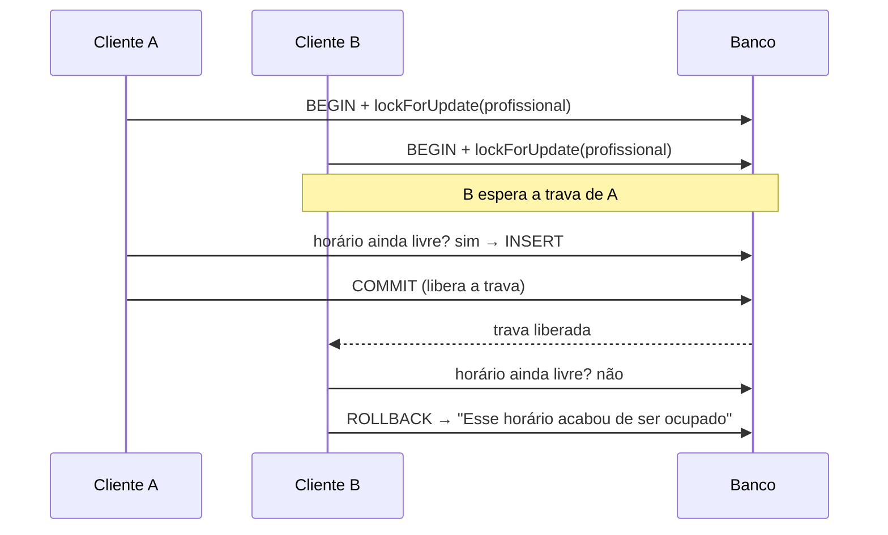

# Agendly

Sistema de agendamento online para negócios de serviço (barbearia, salão, estúdio). O cliente escolhe serviço, profissional e horário em uma página pública, **sem criar conta**. O estabelecimento gerencia tudo por um painel administrativo.

**Stack:** PHP 8.3+ · Laravel 13 · Filament 5 · SQLite (troca por MySQL/Postgres só pelo `.env`) · PHPUnit

---

## Funcionalidades

### Página pública (`/agendar`)
- Escolha de serviço → profissional que realiza aquele serviço → dia → horário livre.
- Horários calculados em tempo real a partir da jornada do profissional, folgas e agendamentos existentes.
- Ao confirmar, o cliente recebe um **link secreto** (`/agendamento/{token}`) que serve de comprovante.
- Pelo mesmo link o cliente **cancela sozinho** até 2h antes do horário. O horário volta a ficar livre na hora.

### Painel administrativo (`/admin`)
- **Início:** resumo do dia: atendimentos ativos, próximo cliente, faturamento previsto e faltas.
- **Agenda:** abas Hoje / Próximos / Anteriores, filtros por profissional, status e dia, busca por nome ou telefone.
  - Agendamento pelo painel (telefone/balcão), com a mesma proteção contra conflito da página pública.
  - Mudança de status com regras de transição (veja abaixo).
- **Serviços:** nome, duração, preço, ativo/inativo.
- **Profissionais:** serviços que realiza e jornada por dia da semana, com vários blocos por dia (pausa de almoço).
- **Folgas e bloqueios:** férias, consultas, feriados. Some da página pública imediatamente.

---

## Regras de negócio

| Regra | Onde |
|---|---|
| O serviço inteiro precisa caber num bloco de trabalho (um corte de 60 min não começa às 11:30 se o bloco acaba às 12:00) | `AvailabilityService` |
| Horários passados não são oferecidos; agendamento até 60 dias à frente | `AvailabilityService`, Form Requests |
| Agendamentos podem ser colados (10:00–10:30 e 10:30–11:00), mas nunca sobrepostos | `AvailabilityService`, `BookingService` |
| Só **Pendente** e **Confirmado** ocupam a agenda; cancelado/concluído/falta liberam o horário | `AppointmentStatus::blocking()` |
| Pendente → Confirmado/Cancelado · Confirmado → Concluído/Faltou/Cancelado · demais são finais | `AppointmentStatus::allowedTransitions()` |
| Concluído e Faltou só depois que o horário começou | `Appointment::canTransitionTo()` |
| Folga não pode ser criada por cima de agendamentos ativos: o admin resolve esses antes | `TimeOff::conflictingAppointments()` |
| Serviço ou profissional com histórico não é excluído, apenas desativado | `ServicePolicy`, `ProfessionalPolicy` |
| Agendamento não é editado nem excluído pelo painel: só muda de status | `AppointmentPolicy` |

### Proteção contra agendamento duplicado

Dois clientes podem abrir a página ao mesmo tempo, ver o mesmo horário livre e clicar em "Confirmar" juntos. Para que só um consiga, o `BookingService` faz tudo dentro de uma transação:



A trava é na linha do **profissional**, não do horário. Assim ela serializa só os agendamentos daquele profissional e cobre também serviços de durações diferentes que se sobrepõem parcialmente.

---

## Como rodar

```bash
git clone https://github.com/ArthurCoode/Agendly.git
cd Agendly

composer install
cp .env.example .env
php artisan key:generate

touch database/database.sqlite   # no Windows: New-Item database/database.sqlite
php artisan migrate --seed

php artisan serve
```

- Página pública: http://localhost:8000
- Painel: http://localhost:8000/admin · `admin@agendly.test` / `password`

O seeder cria 3 serviços e 2 profissionais com jornada de segunda a sábado (09–12h e 13–18h).

### Produção
- Defina `ADMIN_EMAIL` e `ADMIN_PASSWORD` no `.env`. Sem senha definida, o seeder se recusa a rodar em produção.
- `APP_TIMEZONE` (padrão `America/Sao_Paulo`) define o "hoje" da agenda e quais horários já passaram.

---

## Testes

```bash
php artisan test
```

43 testes cobrindo cálculo de horários, conflito de agendamento, fluxo público, cancelamento pelo cliente e telas e ações do painel.

---

## Estrutura

```
app/
├── Enums/AppointmentStatus.php        # status, cores, transições permitidas
├── Services/
│   ├── AvailabilityService.php        # calcula horários livres
│   └── BookingService.php             # cria agendamento com trava (transação + lock)
├── Http/Controllers/BookingController.php
├── Models/                            # Appointment, Professional, Service, TimeOff, WorkingHour
├── Policies/                          # o que o painel pode ou não fazer
└── Filament/
    ├── Resources/                     # Agenda, Serviços, Profissionais, Folgas
    └── Widgets/TodayOverview.php      # resumo do dia
```

## Próximos passos possíveis
- E-mail/WhatsApp de confirmação com o link de cancelamento.
- Reagendamento pelo link (hoje: cancelar e agendar de novo).
- Múltiplos estabelecimentos (multi-tenant).
